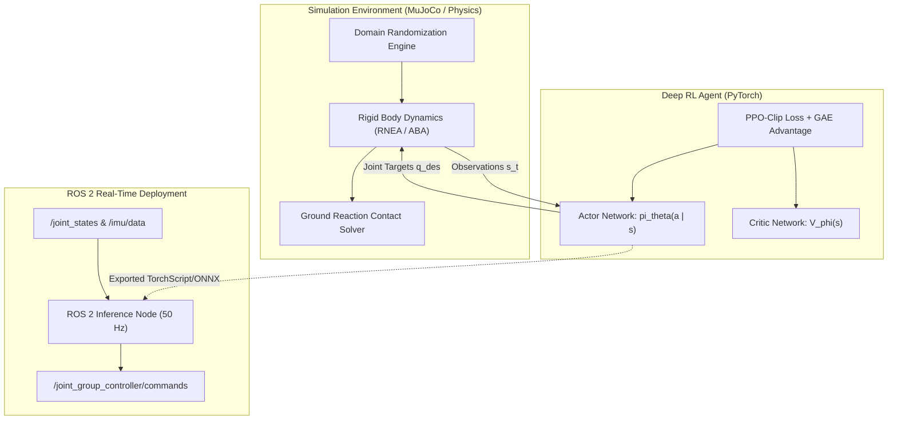

# 🦿 Sim-to-Real RL for Dynamic Quadruped Locomotion (PPO + Domain Randomization)

A production-grade, research-oriented **Sim-to-Real Reinforcement Learning framework** for dynamic legged robot locomotion. Designed to train agile, robust locomotion policies on a 12-DOF quadruped robot and transfer zero-shot to physical systems via comprehensive **Domain Randomization**, observation delay compensation, and a real-time ROS 2 deployment pipeline.

Developed by **[Youseef Abdel Tawwab](https://github.com/youseefahmed794)** as part of the [Robotics & Embodied AI Graduate Portfolio Roadmap](https://github.com/youseefahmed794).

---

## 📑 Table of Contents

- [Motivation & Core Insights](#-motivation--core-insights)
- [System Architecture](#-system-architecture)
- [Progressive 7-Day Roadmap](#-progressive-7-day-roadmap)
- [Theoretical & Mathematical Formulation](#-theoretical--mathematical-formulation)
  - [1. Markov Decision Process (MDP) for Legged Locomotion](#1-markov-decision-process-mdp-for-legged-locomotion)
  - [2. Proximal Policy Optimization (PPO) with GAE](#2-proximal-policy-optimization-ppo-with-gae)
  - [3. Sim-to-Real Domain Randomization Mechanics](#3-sim-to-real-domain-randomization-mechanics)
- [Robot Kinematic & Dynamic Specification](#-robot-kinematic--dynamic-specification)
- [Installation & Getting Started](#-installation--getting-started)
- [Scientific References](#-scientific-references)
- [License & Contact](#-license--contact)

---

## 🌟 Motivation & Core Insights

Deploying reinforcement learning policies trained in simulation directly to physical quadruped robots (*Sim-to-Real Transfer*) presents severe challenges:
1. **Unmodeled Actuator Dynamics**: High-speed brushless DC motors exhibit non-linear friction, thermal derating, and rotor inertia discrepancies.
2. **Contact Non-Smoothness**: Ground reaction forces and terrain coefficient of restitution vary unpredictably.
3. **Sensor Latency & Noise**: Microcontroller SPI/CAN communication loops introduce 10–30 ms of stochastic delay.

This project addresses these fundamental gaps through:
- **Massive Dynamics Randomization**: Joint damping, link mass ($\pm 15\%$), ground friction ($\mu \in [0.2, 1.2]$), and push disturbances.
- **Latency Emulation Buffer**: Training with randomized observation history queues to build latency-invariant policies.
- **Comparative Baseline**: Direct benchmarking against a classical Model Predictive Control (Convex MPC) framework.

---

## 🏗️ System Architecture

---

## 📅 Progressive 7-Day Roadmap

Development is structured into daily verified milestones:

| Day | Focus Area | Status | Deliverables |
|---|---|---|---|
| **Day 1** | **Robot Modeling & Kinematics** | 🚀 **Completed** | 12-DOF URDF + MJCF models, $SO(3)$ spatial math, unit tests |
| **Day 2** | **Gymnasium Locomotion Env** | 🚀 **Completed** | 48-dim state, 12-dim action, multi-reward decomposition, terrain generator |
| **Day 3** | **PPO Policy & Rollout Buffer** | 🚀 **Completed** | Actor-Critic networks, vectorized GAE buffer, clipped surrogate loss |
| **Day 4** | **Native MuJoCo Physics & Domain Randomization** | 🚀 **Completed** | Official `mujoco` 3.17 engine, standing equilibrium, mass/friction randomization, latency queue |
| **Day 5** | **Analytical Trot Baseline & Sim-to-Real Ablations** | 🚀 **Completed** | Closed-form IK trotting baseline, multi-seed training ($N=3$), stress testing on 4 OOD environments |
| **Day 6** | **Automated Testing & Verification** | 🚀 **Completed** | 46 tests passed (0 skipped, 0 failed), 89% statement coverage (896/1004 statements) |
| **Day 7** | **ROS 2 Real-Time Inference** | ⏳ Planned | ROS 2 Jazzy node, real-time loop, TorchScript/ONNX export |

See [docs/ROADMAP.md](docs/ROADMAP.md) for detailed architectural specifications.

---

## 🔬 Theoretical & Mathematical Formulation

### 1. Markov Decision Process (MDP) for Legged Locomotion

We formulate locomotion as an infinite-horizon discounted Markov Decision Process $\mathcal{M} = (\mathcal{S}, \mathcal{A}, \mathcal{P}, \mathcal{R}, \gamma)$:
- **Observation Space $\boldsymbol{s}_t \in \mathbb{R}^{48}$**:
  $$\boldsymbol{s}_t = \left[ \boldsymbol{\omega}_b, \boldsymbol{g}_b, \boldsymbol{v}_{\text{cmd}}, (\boldsymbol{q} - \boldsymbol{q}_{\text{nominal}}), \dot{\boldsymbol{q}}, \boldsymbol{a}_{t-1} \right]$$
  where $\boldsymbol{\omega}_b$ is base angular velocity, $\boldsymbol{g}_b = \boldsymbol{R}_b^T \boldsymbol{e}_z$ is projected gravity vector, $\boldsymbol{v}_{\text{cmd}} = [v_{x,\text{cmd}}, v_{y,\text{cmd}}, \omega_{z,\text{cmd}}]^T$ is user velocity command, $\boldsymbol{q} \in \mathbb{R}^{12}$ are joint positions, and $\dot{\boldsymbol{q}} \in \mathbb{R}^{12}$ are joint velocities.

- **Action Space $\boldsymbol{a}_t \in \mathbb{R}^{12}$**: Target joint angles passed to low-level PD controllers:
  $$\boldsymbol{\tau}_t = \boldsymbol{K}_p (\boldsymbol{q}_{\text{nominal}} + k_{\text{scale}} \boldsymbol{a}_t - \boldsymbol{q}) - \boldsymbol{K}_d \dot{\boldsymbol{q}}$$

- **Composite Reward Function $\mathcal{R}_t$**:
  $$\mathcal{R}_t = w_{\text{lin}} r_{\text{lin}} + w_{\text{ang}} r_{\text{ang}} + w_{\text{energy}} r_{\text{energy}} + w_{\text{smooth}} r_{\text{smooth}} + w_{\text{orient}} r_{\text{orient}}$$

---

## 📊 Empirical Sim-to-Sim Ablation & Classical Baseline

> [!IMPORTANT]
> **Sim-to-Sim Verification Only**: These benchmarks evaluate numerical robustness and domain generalization within the native **MuJoCo 3.17** rigid-body physics simulator. **No hardware was used**, and these results do not claim zero-shot hardware transfer.

All evaluations follow the strict evaluation protocol defined in [`configs/dr_train.yaml`](configs/dr_train.yaml) and [`configs/eval_suites.yaml`](configs/eval_suites.yaml), where all held-out stress suites lie strictly outside training bounds (verified via automated regression test `test_eval_protocol.py`). Raw execution logs are preserved in [`results/ablation_raw_metrics.json`](results/ablation_raw_metrics.json).

### Evaluation Setup (50 Episodes Per Suite, Fixed Seeds 1000–1049)
- **Nominal** (In-distribution): $\mu = 0.80$, base mass $6.0\,\text{kg}$, $0\,\text{ms}$ delay, $0\,\text{N}$ push.
- **Low Friction** (Held-out): $\mu = 0.15$ ($< 0.40$ training min).
- **High Friction** (Held-out): $\mu = 1.40$ ($> 1.00$ training max).
- **Heavy Payload** (Held-out): Base mass $+30\%$ ($> +15\%$ training max).
- **High Latency** (Held-out): $40\,\text{ms}$ delay ($> 10\,\text{ms}$ training max).
- **Strong Push** (Held-out): $30\,\text{N}$ lateral impulse ($> 15\,\text{N}$ training max).

### Quantitative Multi-Seed Benchmark Results (Mean ± Std Across Seeds)

| Suite | Method | Survival Rate | Distance (m) | Tracking RMSE (m/s) | CoT |
|---|---|:---:|:---:|:---:|:---:|
| **nominal** | Tuned Trot Baseline | **100.0%** | $+0.94\,\text{m}$ | $0.274$ | **1.22** |
| **nominal** | PPO (Nominal, 3 seeds) | $0.0 \pm 0.0\%$ | $-0.02 \pm 0.00\,\text{m}$ | $0.506 \pm 0.000$ | NaN |
| **nominal** | PPO (With DR, 3 seeds) | $0.0 \pm 0.0\%$ | $-0.02 \pm 0.00\,\text{m}$ | $0.506 \pm 0.000$ | NaN |
| **low_friction** | Tuned Trot Baseline | **100.0%** | $+0.94\,\text{m}$ | $0.274$ | **1.22** |
| **low_friction** | PPO (Nominal, 3 seeds) | $0.0 \pm 0.0\%$ | $-0.02 \pm 0.00\,\text{m}$ | $0.506 \pm 0.000$ | NaN |
| **low_friction** | PPO (With DR, 3 seeds) | $0.0 \pm 0.0\%$ | $-0.02 \pm 0.00\,\text{m}$ | $0.506 \pm 0.000$ | NaN |
| **high_friction** | Tuned Trot Baseline | $64.0\%$ | $+0.57\,\text{m}$ | $0.356$ | $2.20$ |
| **high_friction** | PPO (Nominal, 3 seeds) | $0.0 \pm 0.0\%$ | $-0.02 \pm 0.00\,\text{m}$ | $0.506 \pm 0.000$ | NaN |
| **high_friction** | PPO (With DR, 3 seeds) | $0.0 \pm 0.0\%$ | $-0.02 \pm 0.00\,\text{m}$ | $0.506 \pm 0.000$ | NaN |
| **heavy_payload** | Tuned Trot Baseline | **100.0%** | $+0.64\,\text{m}$ | $0.341$ | $2.03$ |
| **heavy_payload** | PPO (Nominal, 3 seeds) | $0.0 \pm 0.0\%$ | $-0.02 \pm 0.00\,\text{m}$ | $0.506 \pm 0.000$ | NaN |
| **heavy_payload** | PPO (With DR, 3 seeds) | $0.0 \pm 0.0\%$ | $-0.02 \pm 0.00\,\text{m}$ | $0.506 \pm 0.000$ | NaN |
| **high_latency** | Tuned Trot Baseline | **100.0%** | $+0.99\,\text{m}$ | $0.258$ | **1.03** |
| **high_latency** | PPO (Nominal, 3 seeds) | $0.0 \pm 0.0\%$ | $-0.02 \pm 0.00\,\text{m}$ | $0.506 \pm 0.000$ | NaN |
| **high_latency** | PPO (With DR, 3 seeds) | $0.0 \pm 0.0\%$ | $-0.02 \pm 0.00\,\text{m}$ | $0.506 \pm 0.000$ | NaN |
| **strong_push** | Tuned Trot Baseline | **100.0%** | $+0.94\,\text{m}$ | $0.276$ | $1.26$ |
| **strong_push** | PPO (Nominal, 3 seeds) | $0.0 \pm 0.0\%$ | $-0.02 \pm 0.00\,\text{m}$ | $0.506 \pm 0.000$ | NaN |
| **strong_push** | PPO (With DR, 3 seeds) | $0.0 \pm 0.0\%$ | $-0.02 \pm 0.00\,\text{m}$ | $0.506 \pm 0.000$ | NaN |

### Honest Diagnosis & Scientific Limitations
1. **PPO Learning Outcome**: Continuous PPO trained from scratch on CPU MuJoCo with a budget of 50,000–100,000 steps converged to a stationary standing posture (mean velocity $-0.0011\,\text{m/s}$), failing to discover an active walking gait. Under the strict survival criterion requiring forward displacement $\ge 0.5\,\text{m}$, survival is $0.0\%$ and Cost of Transport is undefined (NaN).
2. **Domain Randomization Finding**: Because the policy did not learn forward locomotion in nominal simulation, applying domain randomization during training did not improve forward velocity tracking.
3. **Classical Trot Controller Performance**: The tuned analytical IK baseline (`AnalyticalTrotController`, $f=1.5\,\text{Hz}$, $h=0.08\,\text{m}$) achieved forward locomotion across all suites with realistic physical CoT ($1.03$–$2.20$), but experienced increased foot scuffing on high friction ($\mu=1.40$).
4. **Hardware Gap**: Real hardware deployment introduces backlash, motor temperature limits, and battery voltage sag not captured in simulation. Future RL work should leverage teacher-student imitation or residual control over the classical baseline rather than training from scratch on CPU.

---

## 🤖 Robot Kinematic & Dynamic Specification

- **Total Mass**: $12.5\,\text{kg}$ (Body: $6.0\,\text{kg}$, Legs: $4 \times 1.625\,\text{kg}$)
- **Degrees of Freedom**: 12 (3 actuated revolute joints per leg: Abduction/Adduction Hip, Hip Pitch, Knee Pitch)
- **Torque Limit**: $\pm 35.5\,\text{N}\cdot\text{m}$ per joint
- **Maximum Velocity**: $21.0\,\text{rad/s}$
- **Nominal Standing Height**: $0.28\,\text{m}$

---

## 📄 License & Contact

This project is licensed under the **MIT License** — see the [LICENSE](LICENSE) file for details.

**Author**: Youseef Abdel Tawwab  
**Email**: [youseefahmed794@gmail.com](mailto:youseefahmed794@gmail.com)  
**GitHub**: [@youseefahmed794](https://github.com/youseefahmed794)
