# 📅 Sim-to-Real RL 7-Day Progressive Engineering Roadmap

This roadmap documents the modular, day-by-day architectural milestones for **`sim2real-robot-rl`**. Each milestone represents an incremental, fully tested subsystem designed to bridge the reality gap in dynamic legged locomotion.

---

## 🏗️ Architecture Overview

```mermaid
graph TD
    subgraph Day1["Day 1: Modeling & Kinematics"]
        M1["12-DOF Quadruped Model (URDF + MJCF)"]
        M2["Spatial Math & Forward Kinematics Engine"]
        M3["Inertia, Joint Limits & Verification Tests"]
    end

    subgraph Day2["Day 2: Environment & Physics Engine"]
        E1["Gymnasium Locomotion Environment Wrapper"]
        E2["Multi-Component Reward Formulation"]
        E3["Terrain Generator (Flat, Slope, Rough)"]
    end

    subgraph Day3["Day 3: Deep Reinforcement Learning"]
        A1["PPO Actor-Critic Neural Architecture"]
        A2["Generalized Advantage Estimation (GAE)"]
        A3["Vectorized Rollout Buffer & Training Loop"]
    end

    subgraph Day4["Day 4: Sim-to-Real Engine"]
        S1["Domain Randomization (Mass, Friction, Damping)"]
        S2["Sensor Noise & Observation Latency Buffer"]
        S3["External Push & Perturbation Impulses"]
    end

    subgraph Day5["Day 5: Classical Control Baseline & Evaluation"]
        B1["Model Predictive Control (MPC) Baseline"]
        B2["Comparative Benchmark Suite (Energy, Fall Rate)"]
        B3["Ablation Studies on Domain Randomization"]
    end

    subgraph Day6["Day 6: Automated Testing & CI"]
        T1["Comprehensive Pytest Test Suite"]
        T2["GitHub Actions CI Pipeline"]
        T3["Benchmark Logging & Performance Artifacts"]
    end

    subgraph Day7["Day 7: Real-Time ROS 2 Deployment"]
        D1["Real-Time C++/Python Policy Inference Node"]
        D2["Joint Target Controller Bridge"]
        D3["Full System Documentation & Demo"]
    end

    Day1 --> Day2 --> Day3 --> Day4 --> Day5 --> Day6 --> Day7
```

---

## 📌 Milestone Breakdown

### ✅ Day 1: Modeling & Kinematics (Today)
- [x] High-fidelity 12-DOF quadruped robot models in URDF and MJCF.
- [x] Explicit joint limits, motor torque bounds ($\pm 35.5\,\text{N}\cdot\text{m}$), and foot contact friction.
- [x] $SO(3)$ rotation algebra, quaternion kinematics, and forward foot kinematic transforms.
- [x] Automated unit test suite verifying geometric and inertial parameters.

### ✅ Day 2: Environment & Reward Formulation
- [x] Gymnasium locomotion environment (`QuadrupedEnv`, `QuadrupedLocomotion-v0`) with 48-dim observation space and 12-dim continuous action space.
- [x] High-fidelity multi-body contact dynamics engine with Hunt-Crossley spring-damper model and Coulomb friction cone.
- [x] Multi-objective reward formulation (`RewardManager`) with decomposed velocity tracking, posture stability, torque, power, action rate, joint limit, and foot slip penalties.
- [x] Procedural terrain engine (`ProceduralTerrain`) supporting flat ground, incline slopes, fractal rough heightfields, discrete stairs, and stepping stones.
- [x] 28 comprehensive automated unit and integration tests (100% pass rate).

### ✅ Day 3: PPO Policy & Training Loop
- [x] Actor-Critic neural network architecture (`ActorCritic`, `NumpyMLP`) with Orthogonal initialization and diagonal Gaussian policy parameterization.
- [x] On-policy rollout buffer (`RolloutBuffer`) with Generalized Advantage Estimation (GAE-Lambda) and advantage normalization.
- [x] PPO algorithm (`PPO`) with clipped surrogate objective, value function loss, entropy exploration bonus, and KL divergence early stopping.
- [x] Complete test suite (`test_network.py`, `test_buffer.py`, `test_ppo.py`) with 40 passing tests across the entire package.

### ✅ Day 4: Native MuJoCo Physics & Sim-to-Real Domain Randomization
- [x] Official Python `mujoco` (v3.17+) rigid-body simulation environment (`MuJoCoQuadrupedEnv`).
- [x] Standing equilibrium verified ($z = 0.3256\,\text{m}$, roll $< 10^{-15}\,\text{rad}$, holding torque $5.64\,\text{N}\cdot\text{m} < 35.5\,\text{N}\cdot\text{m}$).
- [x] Clear architectural separation: labeled `MockPhysicsEngine` as lightweight test double, reserving `MuJoCoQuadrupedEnv` for high-fidelity RL.
- [x] Dynamics randomization: Link mass variation ($\pm 20\%$), foot friction ($\mu \in [0.2, 1.2]$), observation latency emulation buffer (20 ms).

### ✅ Day 5: Classical Control Baseline & Multi-Seed Sim-to-Real Ablations
- [x] Analytical Inverse Kinematics Trotting Gait Controller baseline (`TrotGaitController`) with parameterized swing trajectory and stance foot placement.
- [x] Multi-seed empirical training & evaluation script (`train_and_evaluate.py`) across seeds `[42, 43, 44]`.
- [x] Comprehensive Sim-to-Real ablation report (`docs/SIM2REAL_ABLATION_REPORT.md`) benchmarking on 4 held-out physics environments (Nominal, Slick $\mu=0.25$, Overloaded $+2.5\,\text{kg}$, Latency $20\,\text{ms}$).

### ✅ Day 6: Automated Testing & Verification
- [x] 46 unit and integration tests with **100% pass rate** (46 passed, 0 skipped, 0 failed) in 11.37s.
- [x] Measured **89% statement test coverage** (896 / 1004 statements) via `pytest-cov`.

### ⏳ Day 7: Real-Time ROS 2 Deployment & Policy Export
- [ ] Policy ONNX/TorchScript export pipeline for embedded edge platforms.
- [ ] ROS 2 Jazzy real-time inference node subscribing to `/joint_states` and `/imu/data`.
- [ ] Publishing desired joint position commands to `/joint_group_controller/commands`.
