# 📅 Sim-to-Real RL 7-Day Progressive Engineering Roadmap

This roadmap documents the modular, day-by-day architectural milestones for **`sim2real-robot-rl`**. Each milestone represents an incremental, fully tested subsystem designed to bridge the reality gap in dynamic legged locomotion.

---

## 🏗️ Architecture Overview

```mermaid
graph TD
    subgraph Day1["Day 1: Modeling & Kinematics"]
        M1["12-DOF Quadruped Model (URDF + MJCF)"]
        M2["Spatial Math & Forward Kinematics Engine"]
        M3["Inertia, Joint Limits & Verification Tests"]
    end

    subgraph Day2["Day 2: Environment & Physics Engine"]
        E1["Gymnasium Locomotion Environment Wrapper"]
        E2["Multi-Component Reward Formulation"]
        E3["Terrain Generator (Flat, Slope, Rough)"]
    end

    subgraph Day3["Day 3: Deep Reinforcement Learning"]
        A1["PPO Actor-Critic Neural Architecture"]
        A2["Generalized Advantage Estimation (GAE)"]
        A3["Vectorized Rollout Buffer & Training Loop"]
    end

    subgraph Day4["Day 4: Sim-to-Real Engine"]
        S1["Domain Randomization (Mass, Friction, Damping)"]
        S2["Sensor Noise & Observation Latency Buffer"]
        S3["External Push & Perturbation Impulses"]
    end

    subgraph Day5["Day 5: Classical Control Baseline & Evaluation"]
        B1["Model Predictive Control (MPC) Baseline"]
        B2["Comparative Benchmark Suite (Energy, Fall Rate)"]
        B3["Ablation Studies on Domain Randomization"]
    end

    subgraph Day6["Day 6: Automated Testing & CI"]
        T1["Comprehensive Pytest Test Suite"]
        T2["GitHub Actions CI Pipeline"]
        T3["Benchmark Logging & Performance Artifacts"]
    end

    subgraph Day7["Day 7: Real-Time ROS 2 Deployment"]
        D1["Real-Time C++/Python Policy Inference Node"]
        D2["Joint Target Controller Bridge"]
        D3["Full System Documentation & Demo"]
    end

    Day1 --> Day2 --> Day3 --> Day4 --> Day5 --> Day6 --> Day7
```

---

## 📌 Milestone Breakdown

### ✅ Day 1: Modeling & Kinematics (Today)
- [x] High-fidelity 12-DOF quadruped robot models in URDF and MJCF.
- [x] Explicit joint limits, motor torque bounds ($\pm 35.5\,\text{N}\cdot\text{m}$), and foot contact friction.
- [x] $SO(3)$ rotation algebra, quaternion kinematics, and forward foot kinematic transforms.
- [x] Automated unit test suite verifying geometric and inertial parameters.

### ⏳ Day 2: Environment & Reward Formulation
- [ ] Gymnasium/Gym locomotion environment with realistic reset and step mechanics.
- [ ] Multi-objective reward function (linear velocity tracking, body stability, torque minimization, foot clearance).
- [ ] Procedural terrain generation (flat ground, discrete obstacles, incline slopes).

### ⏳ Day 3: PPO Policy & Training Loop
- [ ] PyTorch Actor-Critic architecture with Orthogonal Initialization.
- [ ] PPO clipped surrogate objective with entropy bonus and value function loss.
- [ ] High-throughput vectorized rollout buffer with GAE advantage computation.

### ⏳ Day 4: Sim-to-Real Domain Randomization
- [ ] Physics randomization: Link mass variation ($\pm 15\%$), ground friction ($\mu \in [0.2, 1.2]$), motor damping.
- [ ] Observation delay buffer simulating realistic microcontroller communication latency (10–30 ms).
- [ ] Periodic random external impulse pushes ($F_{\text{push}} \in [10, 40]\,\text{N}$).

### ⏳ Day 5: Classical MPC Baseline & Benchmarks
- [ ] Implementation of a Simplified Model Predictive Controller / Convex MPC baseline.
- [ ] Empirical benchmarking suite measuring velocity RMSE, COT (Cost of Transport), and survival rate.
- [ ] Quantitative ablation study: Policy with vs without Domain Randomization on unseen slippery terrain.

### ⏳ Day 6: Automated Testing & CI/CD
- [ ] Complete Pytest coverage across environment, policy, buffer, and math modules.
- [ ] Containerized GitHub Actions CI workflow running unit tests on every push.

### ⏳ Day 7: ROS 2 Deployment & Final Release
- [ ] ROS 2 Jazzy real-time policy inference node subscribing to `/joint_states` and `/imu/data`.
- [ ] Publishing desired joint position commands to `/joint_group_controller/commands`.
- [ ] Final comprehensive documentation with training curves and deployment guidelines.
